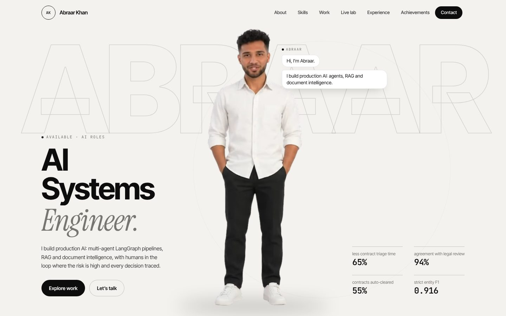
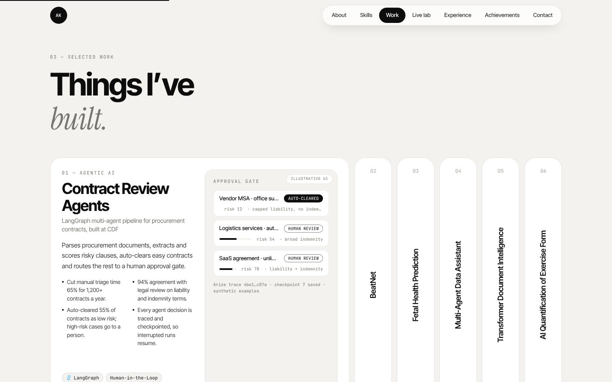
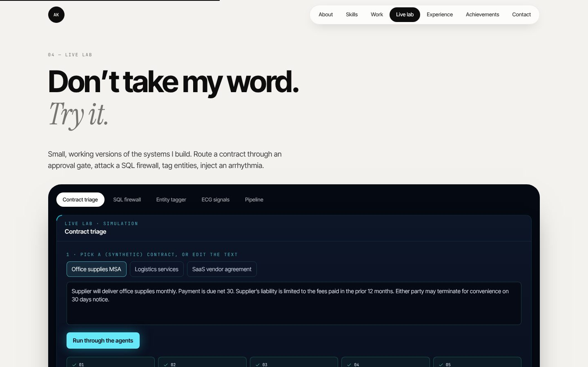

# Abraar Khan: AI Engineer Portfolio

**I build production AI: multi-agent LangGraph pipelines, RAG and document intelligence, with humans in the loop where the risk is high and every decision traced.**

AI Engineer at CDF · M.S. Artificial Intelligence Systems, University of Florida · B.Tech AI & ML, Anna University · Based in the United States · Open to AI roles

[LinkedIn](https://www.linkedin.com/in/abraar-khan-ali) · [GitHub](https://github.com/abraar64mak) · [Email](mailto:abraar.farooqali@gmail.com)



This repository is the source of my personal portfolio. An animated avatar introduces me with chat-style messages (no sound), a lanyard ID card swings and flips, my skills are laid out as a periodic table, and the **Live lab** lets you try small working versions of the systems I build.

## What's on the site

- **About:** a swinging, flippable ID card, a short summary and quick facts.
- **Skills:** 31 skills as "elements" with brand logos, grouped into six families. Hover one to see which projects and jobs used it.
- **Selected work:** an expanding gallery of six projects.
- **Live lab:** contract triage with a human approval gate, a SQL firewall, an entity tagger, an ECG signal demo and a pipeline diagram.
- **Experience and achievements:** a timeline that draws as you scroll, then a pinned gallery of results with count-up numbers.



| Project | What it is |
| --- | --- |
| **Contract Review Agents** (CDF) | LangGraph multi-agent pipeline that parses procurement documents, extracts and scores risky clauses, and routes contracts to review. Cut manual triage 65% for 1,200+ contracts a year, 94% agreement with legal review, 55% auto-cleared, every decision traced with Arize AI and PostgreSQL checkpoints |
| **BeatNet** | Real-time ECG AI on wearables: a 1D U-Net for PQRST detection plus a fine-tuned ECG-FM classifier, with IEC 62304-compliant CI/CD release gates · [GitHub](https://github.com/abraar64mak/Beatnet) |
| **Multi-Agent Data Assistant** | LangGraph and MCP NL-to-SQL over PostgreSQL: 75% execution accuracy, a 65-case adversarial suite passed, sqlglot AST firewall, row-level security and OpenTelemetry traces · [GitHub](https://github.com/abraar64mak/mcp-data-assistant) |
| **Transformer Document Intelligence** | Fine-tuned RoBERTa NER on distributed PySpark behind FastAPI: 0.916 strict entity F1 on 3,453 CoNLL-2003 test samples · [GitHub](https://github.com/abraar64mak/document-intelligence-platform) |
| **Two published papers** | Best Paper awards at IConIC 2K23 ([AIP](https://pubs.aip.org/aip/acp/article-abstract/3175/1/020058/3339024/AI-in-healthcare-Predicting-the-fetus-health-using?redirectedFrom=PDF)) and ICCCNet 2023 ([Springer LNNS](https://link.springer.com/chapter/10.1007/978-981-97-0892-5_50)) |



> The lab demos run on synthetic data with simple rules, and they say so on screen. They illustrate the systems; they are not runs of the production models.

## Tech stack

React 18 · TypeScript · Vite · Tailwind CSS · Framer Motion · Lenis · WebGL (hero video compositing) · Lucide icons · simple-icons. Fonts are self-hosted, with no external scripts or image CDNs at runtime.

## Run it locally

You need [Node.js](https://nodejs.org) 18 or newer.

```bash
npm install
npm run dev          # http://localhost:5173
npm run build        # type-check and production build into dist/
```

`dist/` is a plain static site. `.github/workflows/deploy.yml` builds it and publishes it to GitHub Pages (Settings → Pages → Source: GitHub Actions).

## Structure

```
src/data/        all content: profile, experience, projects, skills, papers
src/components/  sections, ID card, hero player, lab demos
public/hero/     silent hero video (picture and matte packed side by side) and photo fallback
scripts/         build-hero-assets.py, cutout-portrait.py
```

## Credits and copyright

Brand logos from [simple-icons](https://simpleicons.org) (CC0). Icons by [Lucide](https://lucide.dev).

© Abraar Khan. The photos, avatar, video and written content are mine and are not licensed for reuse.
